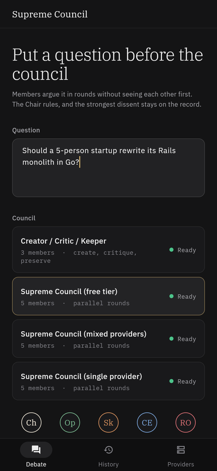
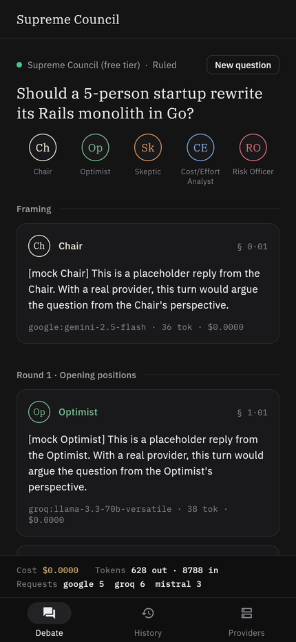
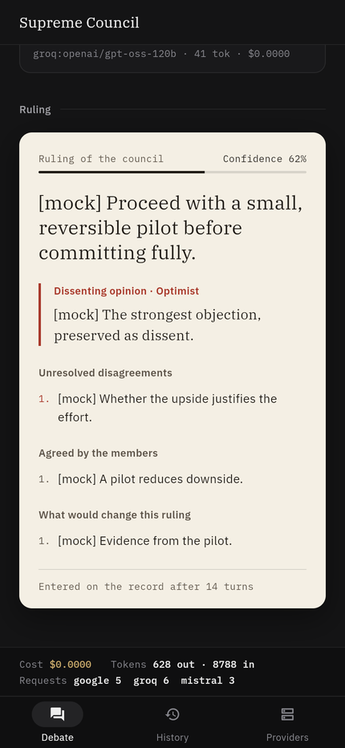
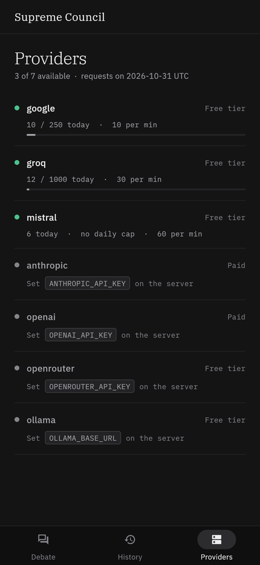

# Supreme Council

> Multi-agent debate where role-based AIs argue, a chair rules, and dissent stays visible.

You ask a question. A council of role-based LLM agents (an Optimist, a Skeptic, a Cost/Effort Analyst and a Risk Officer) argues it over several rounds. A Chair then writes a structured ruling. The ruling always names the strongest dissenting member and lists the disagreements that were never settled, so you see where the council disagreed as well as its answer.

> [!WARNING]
> **Free tiers may use your data for training.** Google AI Studio's free tier, Groq, Mistral's free plan and OpenRouter's free models may use the prompts and outputs you send to train or improve their models. **Do not send confidential questions through a free-tier council** (`supreme-free`, `creator-critic-keeper`). For anything sensitive, use a paid provider with a data agreement you trust, or a local Ollama model.

| Convene | In session | The ruling | Providers |
|---|---|---|---|
|  |  |  |  |

The screenshots come from the Flutter web build talking to the server in `--mock` mode, so the agent text is a placeholder.

## Contents

- [Quick start](#quick-start)
- [How a debate works](#how-a-debate-works)
- [Architecture](#architecture)
- [Running it](#running-it)
- [Getting API keys](#getting-api-keys)
- [Configuration](#configuration)
- [Adding a council](#adding-a-council)
- [Adding a provider](#adding-a-provider)
- [Cost and safety controls](#cost-and-safety-controls)
- [Eval results](#eval-results)
- [Development](#development)

## Quick start

You need Node 20.12 or later.

```bash
npm install
```

Run a debate with canned replies. This needs no API keys:

```bash
npm run debate -- --council supreme-free --mock "Should a 5-person startup rewrite its Rails monolith in Go?"
```

To run it for real, copy `.env.example` to `.env`, add at least one key (see [Getting API keys](#getting-api-keys)), and drop `--mock`:

```bash
npm run debate -- --council supreme-free "Should a 5-person startup rewrite its Rails monolith in Go?"
```

## How a debate works

Each council config has a `protocol` field, and the orchestrator runs whichever protocol it names. Two ship with the project.

### `parallel-rounds` (the Supreme Council)

1. **Framing.** The Chair restates the question and lists the criteria the decision will be judged on.
2. **Round 1, opening positions.** Every member answers in parallel. A member's prompt holds only the question and the Chair's framing; it never contains another member's output, so members cannot anchor on each other. A test checks this.
3. **Round 2, rebuttal.** Each member sees every Round 1 position. It must name one point it disagrees with and one it concedes, each with a concrete reason. If no argument convinced it, it writes "Concede: nothing" and explains why. Members never concede just to be agreeable.
4. **Round 3, final stance** (optional, set with `--rounds 2` or `3`). Each member gives a final stance and a confidence from 1 to 10.
5. **Verdict.** The Chair returns JSON, validated with Zod. On a parse or validation failure the Chair gets the error and one retry:

   ```json
   { "recommendation": "...", "confidence": 0.7,
     "agreements": ["..."], "unresolved_disagreements": ["..."],
     "dissent": { "agent": "skeptic", "reason": "..." },
     "what_would_change_my_mind": ["..."] }
   ```

   `dissent.agent` must name a real member, or `"none"` if the council was unanimous.

Members run in parallel within a round, and each round waits for the previous round to finish.

### `create-critique-preserve` (Creator / Critic / Keeper)

This is a sequential loop. In each cycle:

1. The **Creator** proposes a solution, or improves on the proposal the Keeper kept last cycle.
2. The **Critic** attacks it and ranks its weaknesses.
3. The **Keeper** keeps what survived, fixes what did not, and returns JSON containing `changed`, the revised `proposal` and a `verdict`.

The loop stops when the Keeper reports `changed: false` (no material change) or when it reaches the cycle cap. If a member fails mid-loop, the last good Keeper output stands.

### Keeping agents distinct

The role prompts in `config/roles/` keep members from converging into a bland consensus:

- Each prompt gives the member a separate job and an explicit "stay in your lane" rule. For example, the Skeptic asks "is this reasoning true?" and the Risk Officer asks "if we act, what breaks?"
- Each prompt bans hedging into neutrality.
- The Chair weighs the quality of reasons, not the number of members who agree, and must preserve dissent in its strongest form.

## Architecture

```
            CLI (npm run debate)        Flutter app ──SSE──┐
                    │                                      │
                    │                Fastify server (POST /sessions, GET /sessions/:id/stream, ...)
                    │                            │
                    └──────────► runtime.startSession ◄──── eval harness
                                         │  persists every event
              ┌──────────────────────────┼─────────────────────────┐
              ▼                          ▼                         ▼
   orchestrator (state machine)     SQLite Store            startup report
   parallel-rounds | create-        sessions, events,       provider availability,
   critique-preserve                turns, verdicts,        runnable councils
              │                     daily_requests
              ▼
   callAgent: rate limiter → retries with backoff → fallback models → TurnResult
              │
              ▼
   LLMClient interface ──► AI SDK adapter (the only module that imports a provider SDK)
                            anthropic · openai · google · groq · mistral · openrouter · ollama
```

- **One event stream.** A debate is a sequence of `DebateEvent`s: `turn_start`, `token`, `turn_end`, `round_complete`, `verdict` and `error`. The CLI prints them, the server streams them as SSE, and the store appends them to an event log. A finished session replays by re-sending that log, so the replay is the same stream, event for event. Tests check this, and so did `cmp` on two curl captures.
- **`LLMClient`.** `stream(messages, { model, maxTokens, system })` is an async generator. It yields tokens and returns `{ inputTokens, outputTokens }`. Provider errors are mapped to four kinds:
  - `rate_limit` and `unavailable` are retried.
  - `missing_key` and `rejected` go straight to the next fallback.
- **Turns never crash a session.** `callAgent` works through an agent's model list. Each model is first checked for a key and against the daily quota, then waits its turn in the rate-limiter queue, then is retried with bounded exponential backoff. If every model fails, it returns a failed `TurnResult`, the timeline shows the turn as failed, and the debate continues.
- **No model names in code.** Every model ID lives in `config/`. A test fails if one appears in `src/`. Another test fails if anything other than `src/llm/ai-sdk-client.ts` imports a provider SDK.

```
config/            providers.yaml, prices.yaml, roles/*.md, councils/*.yaml
src/config/        Zod schemas and the loader
src/llm/           LLMClient, the AI SDK adapter, the mock client, --mock replies
src/providers/     rate limiter, retries and fallbacks, availability, startup report
src/orchestrator/  events, prompts, the two protocols, the turn runner
src/db/            SQLite store
src/server/        Fastify app and live-session hub
src/cli/           debate CLI and timeline printer
eval/              questions, eval config, harness
app/               Flutter client
```

## Running it

### CLI

```bash
npm run debate -- [--council <id>] [--rounds <n>] [--mock] [--db <path>] "question"
```

The CLI prints a startup report: which providers have credentials, each provider's limits and today's request count, which councils can run, and any models missing from the price table. It then streams the debate. One turn streams live at a time. Members running in parallel buffer their text and print it whole, so turns never interleave mid-sentence. The verdict prints last, with dissent and unresolved disagreements first among the details, then tokens, cost and requests per provider.

Sessions are saved to `data/council.db`; set `SUPREME_COUNCIL_DB` to use another path. `--mock` runs use a throwaway in-memory database, so they never count toward real quotas.

### Server

```bash
npm start            # real providers, http://127.0.0.1:8787 (PORT and HOST env vars)
npm start -- --mock  # canned replies, separate data/mock.db; good for working on the client
```

| Endpoint | Description |
|---|---|
| `POST /sessions` | Body `{ question, councilId, rounds? }`. Returns `201 { sessionId }`. `rounds` defaults to the council's cap and must be within its limits. |
| `GET /sessions/:id/stream` | SSE: `turn_start`, `token`, `turn_end`, `round_complete`, `verdict`, `error`. A live session sends what has happened so far, then live events. A finished session replays from the database. The stream closes after the last event. |
| `GET /sessions` | Session history. |
| `GET /sessions/:id` | Full session: turns with text, model, tokens and cost, plus the verdict. |
| `GET /providers` | Per provider: available (key present), free tier, rpm, rpd, and requests today. Key values are never returned. |
| `GET /councils` | Councils with their members, round limits and readiness. |

An `error` event that carries a `turnId` and `retrying: true` means the provider failed mid-turn and the turn is being retried. Clients should discard that turn's text so far.

```bash
curl -s -XPOST localhost:8787/sessions -H 'content-type: application/json' \
  -d '{"question":"Should we adopt a 4-day work week?","councilId":"supreme-free","rounds":2}'
```

```bash
curl -N localhost:8787/sessions/<sessionId>/stream
```

### Flutter app

The app lives in `app/`. It has these screens:

- **Convene:** question input, council picker with each council's readiness, a preview of the bench, and a rounds or cycles control.
- **In session:** the bench of member seats, each a monogram ringed in that member's colour, lit while the member speaks. Turns stream in under their round, and each carries a docket mark such as `§ 2·03` (round, then turn).
- **The ruling:** typeset like a written opinion on paper. The dissenting opinion comes straight after the recommendation, followed by numbered unresolved disagreements.
- **Cost bar:** the debate's cost, tokens and requests per provider.
- **Providers:** availability, plus daily quota usage.
- **History:** past sessions; tapping one replays it through the same stream.

The design uses graphite surfaces with a single brass accent, and IBM Plex (Sans, Serif and Mono, under the SIL Open Font License, bundled in `app/assets/fonts`).

Start the server, then run the app:

```bash
cd app
```

```bash
flutter pub get
```

```bash
flutter run --dart-define=API_BASE_URL=http://127.0.0.1:8787
```

On the Android emulator, use `http://10.0.2.2:8787`. In a web build, the browser's HTTP client delivers the stream in one piece when it closes, so tokens stream live only on mobile and desktop. `flutter test` runs the client tests, including one that parses a real SSE capture from the server.

## Getting API keys

A provider whose key is missing is simply unavailable. Agents that use it fall back to their next configured model. The free-tier steps below were accurate when this was written, but these programs change often, so check each provider's site.

| Provider | Free? | Where to get a key | Env var |
|---|---|---|---|
| Google Gemini | Yes, rate-limited | [Google AI Studio](https://aistudio.google.com/apikey): sign in, then **Create API key** | `GOOGLE_API_KEY` |
| Groq | Yes, rate-limited | [console.groq.com/keys](https://console.groq.com/keys): sign up, then **Create API Key** | `GROQ_API_KEY` |
| Mistral | Yes, on the free "Experiment" plan (requires phone verification) | [console.mistral.ai](https://console.mistral.ai/): choose the Experiment plan, then **API Keys** | `MISTRAL_API_KEY` |
| OpenRouter | Models with a `:free` suffix are free, with low daily limits | [openrouter.ai/keys](https://openrouter.ai/keys) | `OPENROUTER_API_KEY` |
| Ollama | Free, runs locally | Install from [ollama.com](https://ollama.com), then run `ollama pull llama3.1:8b` | `OLLAMA_BASE_URL`, for example `http://localhost:11434` |
| Anthropic | Paid | [console.anthropic.com](https://console.anthropic.com/) | `ANTHROPIC_API_KEY` |
| OpenAI | Paid | [platform.openai.com/api-keys](https://platform.openai.com/api-keys) | `OPENAI_API_KEY` |

Keys are read from the environment or from `.env`. The CLI, the server and the startup report print only env var names, never key values.

## Configuration

Everything that changes often lives in `config/`. Nothing is hardcoded.

- **`providers.yaml`:** for each provider, its env var (or a base-URL env var for Ollama), requests per minute (`rpm`), requests per day (`rpd`, or `null` for no cap) and `freeTier`. It also holds the retry policy: `maxAttempts`, `baseDelayMs` and `maxDelayMs`. Free-tier limits change, so edit these numbers rather than code. Requests per day are counted per provider per UTC day in SQLite.
- **`prices.yaml`:** USD per million input and output tokens, keyed by `provider:model`. Free models are listed at $0 but still count toward request quotas. A model missing from the table is costed at $0, and the startup report lists it as unpriced.
- **`roles/*.md`:** role system prompts, which agents reference with `promptRef`.
- **`councils/*.yaml` or `*.json`:** one file per council.

  ```yaml
  id: supreme-free
  name: Supreme Council (free tier)
  protocol: parallel-rounds        # or create-critique-preserve
  maxRounds: 3                     # 2 or 3 (create-critique-preserve uses maxCycles: 1-10)
  chair:
    id: chair
    role: Chair
    promptRef: chair               # or an inline systemPrompt: "..."
    model: google:gemini-2.5-flash # "provider:model"; the model part may contain colons
    fallbackModels: [mistral:mistral-small-latest, ollama:llama3.1:8b]
    maxTokens: 2000                # per turn, hard-capped at 8000
  agents: [ ... ]                  # two or more members
  ```

Three variants of the Supreme Council ship with the project:

- `supreme-single`: Anthropic only.
- `supreme-mixed`: Anthropic, OpenAI, Google and Mistral, so members don't share one model's blind spots.
- `supreme-free`: Google, Groq, Mistral and Ollama only, with OpenRouter as the last-resort fallback for every member.

`creator-critic-keeper` also runs on free providers only.

Model IDs change often. If a provider retires one, the turn fails as `rejected` and falls through to the next fallback. Fix it by editing the YAML.

The Chair's model is chosen separately from the members'. Put it on the provider whose structured JSON output you trust most.

## Adding a council

Add one file to `config/councils/`. You don't touch any code. Here is a hiring panel with inline prompts:

```json
{
  "id": "hiring-panel",
  "name": "Hiring Panel",
  "protocol": "parallel-rounds",
  "maxRounds": 2,
  "chair": { "id": "chair", "role": "Hiring Manager", "systemPrompt": "You chair a hiring panel...", "model": "google:gemini-2.5-flash", "maxTokens": 1500 },
  "agents": [
    { "id": "tech", "role": "Technical Interviewer", "systemPrompt": "You assess technical depth...", "model": "groq:llama-3.3-70b-versatile", "maxTokens": 800 },
    { "id": "team", "role": "Team Lead", "systemPrompt": "You assess collaboration...", "model": "mistral:mistral-small-latest", "maxTokens": 800 }
  ]
}
```

The loader validates the file at startup: model references, unique agent IDs, resolvable `promptRef`s and token caps. Errors point to the exact field. A test adds exactly this kind of file and loads it.

## Adding a provider

A provider needs one adapter, so this is the only change that touches code:

1. Add its ID to `PROVIDER_IDS` in `src/config/schema.ts`.
2. Add a `case` to `languageModel()` in `src/llm/ai-sdk-client.ts` that uses the provider's AI SDK package. For an OpenAI-compatible API, use `createOpenAICompatible` with a `baseUrl`, as OpenRouter does.
3. Add an entry to `config/providers.yaml` with the env var, `rpm`, `rpd` and `freeTier`.
4. Add its models to `config/prices.yaml`.

Run `npm test`. The config tests then fail if any shipped council uses an unpriced or unknown model.

## Cost and safety controls

- **Caps:** at most 3 rounds and 10 cycles, set per council in config. `maxTokens` is set per turn and capped at 8000. Requests above a council's round limit return a 400.
- **Usage tracking:** tokens and cost are tracked for every turn and for the whole session. The `verdict` event carries `{ inputTokens, outputTokens, costUsd, turns: [...], requests: { provider: n } }`.
- **Daily quotas:** a provider that has used up its configured `rpd` for the day is skipped like a missing key, so the debate falls back instead of hitting a hard 429.
- **Rate limits:** each provider has a sliding window of `rpm` requests per minute. Calls over the limit wait in a queue rather than failing, so a parallel round on a 10-rpm free tier is throttled, not rejected.
- **Bounded retries:** backoff is 1s, 2s, 4s and so on, capped at `maxDelayMs`. A `retry-after` header is honoured up to the same cap.
- **Logging:** API keys are never logged or returned. The server logs requests with Fastify's default serializers, which leave out headers.

## Eval results

`eval/` holds 20 yes/no decision questions with known-good answers, in `questions.yaml`. Ten answers are yes and ten are no, so a model that always agrees scores 50%. Several questions are classic traps: sunk cost, base rates, the bat-and-ball problem, Brooks's law, an A/B test with p = 0.8, and the gambler's fallacy.

Grading is deterministic. An answer is correct only if the recommendation begins with the right "Yes" or "No", and every question asks for that format. A missing verdict counts as wrong. The harness compares four conditions:

- **(a) Single-prompt baseline:** one call to the model the `supreme-single` members use. The baseline model is set in `eval/config.yaml`.
- **(b) Same-provider council:** `supreme-single`.
- **(c) Mixed-provider council:** `supreme-mixed`.
- **(d) Free-tier council:** `supreme-free`.

Run it:

```bash
npm run eval
```

These flags narrow or change the run:

```bash
npm run eval -- --conditions free,baseline --limit 5   # a subset
npm run eval -- --mock                                  # check the harness itself
```

A condition whose providers have no keys is skipped rather than failing 20 times. A real run writes `eval/results-<timestamp>.md` with the table and per-question results.

### Results so far

**No real-provider eval has been run yet.** The environment this was built in had no API keys, so every condition was skipped. I won't publish numbers I did not measure. Run `npm run eval` with keys and paste the table here, including any conditions where the council loses.

The `--mock` run only checks the plumbing, and its scores are 0% by construction because the canned replies never say yes or no. Its cost and request columns are still informative. Token counts are mock estimates, priced at the real table:

| Condition (mock, 4 questions) | Cost / question | Requests / question |
|---|---|---|
| (a) single-prompt baseline | $0.0006 | 1 |
| (b) same-provider council | $0.0297 | 14 |
| (c) mixed-provider council | $0.0197 | 14 |
| (d) free-tier council | $0.0000 | 14 |

A three-round council makes 14 calls per question where the baseline makes 1: framing, 4 members × 3 rounds, and the verdict. Its cost is roughly 30-50 times the baseline's. The free-tier council costs $0, but at Google's free-tier default of 250 requests a day, the 20-question eval alone uses most of a day's quota. For the council to be worth it, it has to beat the baseline by more than that cost.

## Development

```bash
npm test             # vitest: 78 tests across config, providers, orchestrator, store, server, eval
```

```bash
npm run typecheck
```

```bash
cd app && flutter analyze && flutter test
```

`--mock` (CLI, server or eval) swaps in a scripted client, so everything except the provider calls can be exercised without keys. `test/ai-sdk-live.test.ts` drives the real AI SDK adapter over HTTP against a local fake OpenAI-compatible server, covering streaming, usage, 429 and 503.
